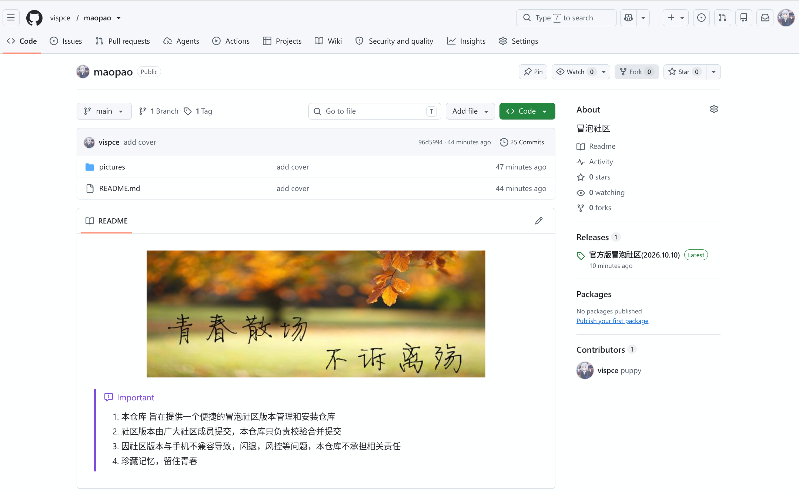
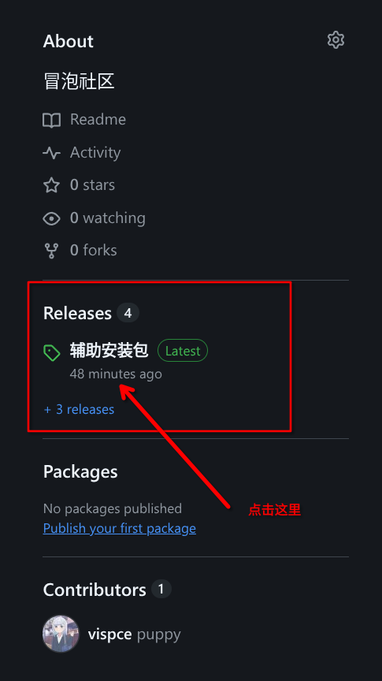
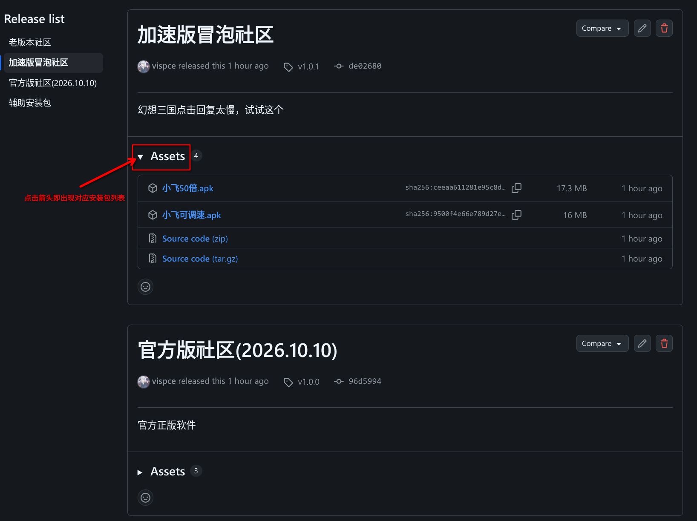

> [!IMPORTANT]
> 
> 1. 本仓库旨在提供一个便捷的冒泡社区版本管理和安装仓库
> 2. 社区版本由广大社区成员提交，本仓库只负责校验合并提交
> 3. 因社区版本与手机不兼容导致，闪退，风控等问题，本仓库不承担相关责任
> 4. 珍藏记忆，留住青春

## 简介
  社区版本复杂多变，功能也有差异。为了方便安装自己想要的版本，特此做了一个版本管理仓库。

## 具体安装方法

> [!TIP]
> _1. 浏览器打开本界面_
> 

> _2. 找到release关键字点击_
> 

> _3. 查看各个版本，并选择心仪的安装包文件下载即可_
> 

> _4. 另外附上官方直链下载_
> [冒泡社区官方](http://dln.51mopo.com/apkf/apk4/M01/00/01/CsADpmeFw9eAait5AT79-8uwwvY637.apk "点击下载")

